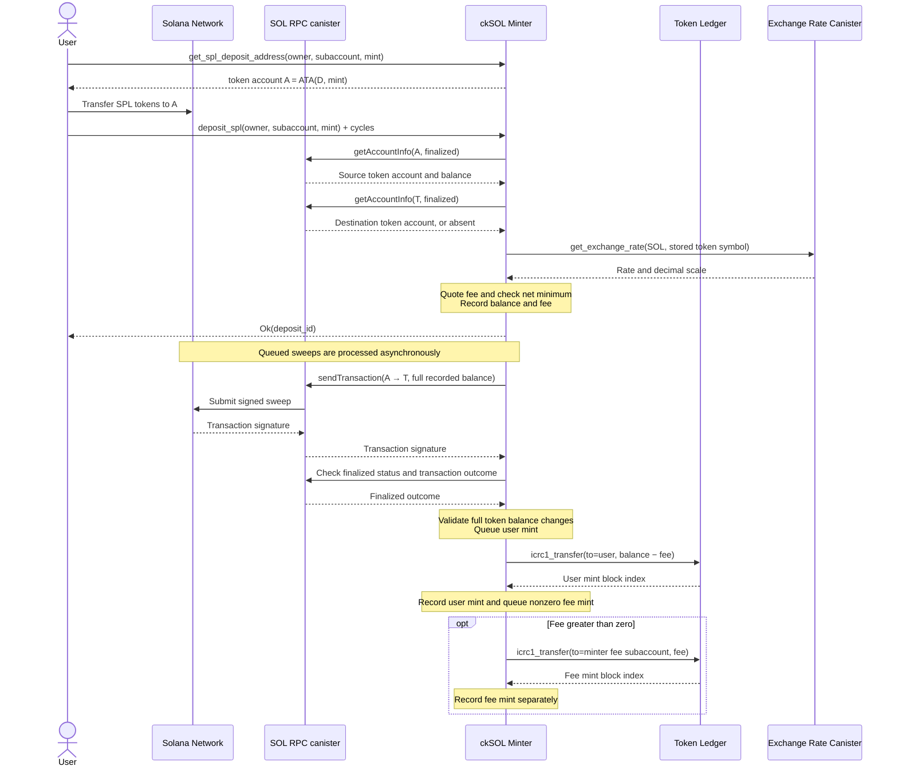
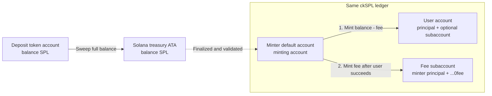
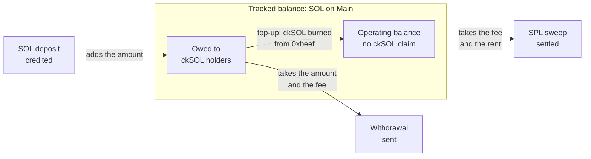

# ckSPL Deposit Flow (Draft)

> **Status:** Implementation in progress. The minter registers tokens, accepts deposits, sweeps and settles them, and mints the user amount and the fee. Burned ckSOL top-ups pay the SOL cost of the sweeps. Unit, PocketIC and validator tests cover these steps. The dashboard does not show SPL deposits.
>
> **Scope:** SPL deposits. The deposit fee uses XRC prices. The conversion of the collected fees into SOL is follow-up work.

## 1. Goal

SPL deposits use the balance-based sweep flow:

1. Each IC account has a derived Solana deposit address. SOL deposits and SPL deposits use the same address.
2. A wallet or an exchange sends SPL tokens to the token account of that address.
3. The user calls `deposit_spl`. The minter reads the finalized balance, records a fee quote and returns a deposit ID.
4. The minter sweeps the full recorded balance into its treasury token account. Then it validates the finalized transaction.
5. The minter mints `balance − fee` to the IC account of the user. After that mint, it mints a nonzero fee into its own fee subaccount on the same ledger.

The user does not need ckSOL to pay the deposit fee. The caller attaches cycles for the account reads, the XRC quote and the consolidation fee.

## 2. Addresses and ledger accounts

| Name | Description |
|---|---|
| `D` | The derived deposit address of the IC account of the user. It is the same address as for SOL |
| `A` = ATA(`D`, `M`) | The source token account for the mint `M` |
| `Main` | The main Solana address of the minter. It pays the sweep transaction fee and the rent of new treasury accounts |
| `T` = ATA(`Main`, `M`) | The treasury token account for the mint `M` |
| User IC account | The principal and the optional subaccount that receive `balance − fee`. If the call omits the owner, the caller is the owner |
| Fee IC account | The minter principal with the subaccount `0x0fee` (`SPL_FEE_SUBACCOUNT`). The ledgers also collect their transfer fees in this account |
| Top-up account | The minter principal with the subaccount `0xbeef` on the ckSOL ledger. It receives ckSOL for the operating balance |

The minter controls `D`, `A`, `Main` and `T`. The SPL tokens move from the sender to `A` and then to `T`. The ledger mints do not move SPL tokens on Solana.

`get_deposit_address` returns `D`. `get_spl_deposit_address` returns `A` for a registered mint. A sender can use it to check the token account before a transfer.

## 3. Token registry

The configured ledger suite orchestrator registers each token with `add_spl_token`. The minter reads the finalized mint account before it records the token.

| Field | Description |
|---|---|
| `mint`, `token_program`, `decimals` | The minter checks them against the finalized mint account. The program must be the classic SPL Token program or Token-2022 |
| `xrc_symbol` | The symbol in which XRC must quote SOL. The minter checks it with XRC at registration |
| `ledger_id` | The ledger on which the minter mints ckSPL. Each ledger serves one mint |
| `minimum_deposit_amount` | The minimum amount that the user receives after the fee, in the smallest units of the mint. It must not be zero |
| `paused` | Rejects new deposits. A deposit in flight continues |

The minter rejects these registrations:

- A Token-2022 mint with extensions.
- A mint that is already registered (`AlreadySupported`).
- A ledger that serves another mint, or the ckSOL ledger (`LedgerAlreadyUsed`).
- An empty XRC symbol, or a symbol that XRC does not quote (`InvalidToken`).

If XRC is not available, the registration fails with `TemporarilyUnavailable`. The registry does not store a fee. The `QueuedSplDeposit` event records the quote of each deposit.

## 4. Deposit sequence



`deposit_spl` does these checks in this order:

1. The owner must not be anonymous or the minter.
2. A concurrent request for the same account and mint fails with `AlreadyProcessing`.
3. If a deposit for the account and mint is in flight, the call returns its ID. In flight means queued, swept, finalized, waiting for a mint, or quarantined. This step makes no quote, no RPC call and no cycle charge. It also applies when the token is paused.
4. The mint must be registered (`UnsupportedToken`) and not paused (`TokenPaused`).
5. The caller must attach cycles for two account reads, one XRC request and the consolidation fee (`InsufficientCycles`).
6. The source account `A` must have the expected token program, mint and owner, and it must not be frozen. A Token-2022 account can have only the `ImmutableOwner` and `MemoTransfer` extensions. A missing account has a zero balance. The minter rejects a balance below the configured minimum before it makes more calls.
7. If `T` exists, the minter validates it. The sweep creates `T` if it is absent, or if it is a prefunded system account without data.
8. The minter quotes the fee through XRC with the stored symbol and decimals of the token. If the quote fails, the call fails with `TemporarilyUnavailable`.
9. The balance must be at least `minimum_deposit_amount + fee` (`ValueTooSmall`). Thus the net mint of the user is at least the configured minimum.

A failed check of a token account fails with `InvalidTokenAccount` and the reason. The minter charges the actual cost of each external call. It keeps the consolidation fee only when it queues the deposit.

## 5. Fees and accounting

There are three separate costs:

| Cost | Currency | Who pays |
|---|---|---|
| Deposit fee | SPL token units | The user. The minter quotes it at acceptance, deducts it from the user mint and mints it into the fee IC account |
| Account reads, XRC quote and consolidation fee | IC cycles | The caller. The minter refunds unused call cycles. It keeps the consolidation fee only when it queues the deposit |
| Sweep transaction fee and rent of new treasury accounts | SOL lamports | The minter, from its operating balance |

For a recorded balance `b` and a fee `f`:

```text
SPL transferred to T = b
ckSPL minted to the user = b − f
ckSPL minted to the fee IC account = f
Total ckSPL minted after both mints = b
```



The full accepted balance reaches `T`, which includes the fee part. While the fee mint is pending or quarantined, no ckSPL represents that part. The fee mint creates that ckSPL. It does not need a Solana transfer.

### Fee quote

The quote estimates the cost of a sweep with one deposit: two signatures, plus the rent of `T` when `T` is missing, plus a 20% margin. The rent of a classic token account is 2,039,280 lamports. The rent of a Token-2022 token account is 2,074,080 lamports. A prefunded `T` without data also gets the full rent estimate. A batch can cost less. Deposits that arrive before `T` exists can each get a rent estimate.

`FeeEstimator` converts the SOL estimate into token units with the SOL rate from XRC. It applies the decimals of the token and of the rate, and it rounds up. The minter rejects a rate that is more than five minutes from its own time, a zero rate, a different asset pair and a fee above `u64`. The recorded quote does not change in sweep retries, ledger retries or event replay.

### Operating balance

ckSOL holders own most of the SOL on `Main`, so the minter must not spend that SOL on SPL sweeps. The **operating balance** is the part of the tracked balance that no ckSOL backs. SPL sweeps spend only this part.

The diagram shows how each flow changes the two parts of the tracked balance. A top-up moves lamports from one part to the other. No SOL moves on Solana.



An operator funds the operating balance with ckSOL:

1. Send ckSOL with `icrc1_transfer` to the top-up account. `get_operating_balance` returns this account.
2. Call `process_operating_top_up`. Any caller can call it. It has no arguments.
3. The minter reads the balance of the top-up account and burns all of it with `BurnMemo::TopUp`. It records `ToppedUpOperatingBalance` with the burn index and the amount, and it returns both.

The burn removes the claim of ckSOL holders on SOL that is already on `Main`. No SOL moves, and the tracked balance does not change. Only the operating balance increases.

- If the top-up account is empty, the call fails with `NoFunds`.
- If the ledger fails, the ckSOL stays in the top-up account for a later call.
- A guard on the top-up account lets only one call run at a time.
- If the burn succeeds but its reply is lost, the operating balance does not get the amount.

An operator who has SOL deposits it with `deposit_sol` first, and then sends the minted ckSOL to the top-up account.

### Reservations and limits

A submitted sweep reserves its maximum cost: the fee of its signatures plus the rent of one treasury account for each mint, at the size of its token program. The reservation never exceeds the balance. The minter takes the reservation from the balance and from the operating balance. Thus withdrawals and other sweeps cannot spend it before the sweep settles.

| Outcome | Change to the balance and the operating balance |
|---|---|
| Credited | Return the reservation and debit the real spend |
| Failed | Return the reservation and debit the fee of the signatures |
| Expired | Return the reservation |
| Quarantined | Keep the reservation, because the spend is unknown |

If a sweep spends more than its reservation, the operating balance stops at zero.

Withdrawals spend the balance above the rent exemption of `Main` (`State::spendable_balance`). SPL sweeps spend at most the smaller of that amount and the operating balance (`State::spl_sweep_allowance`). Withdrawals do not check the operating balance. If the backing is complete, they never need it. If the backing is not complete, ckSOL holders come first.

Each flow reads its limit before its asynchronous work. It reads the limit again immediately before it records its commitment, with no await between the two steps. If the balance does not cover a withdrawal batch after its nonce read, the batch stays pending for the next round. If the allowance does not cover a signed SPL sweep, the minter does not record or send it, and its deposits stay queued.

The sweep timer submits only the sweeps that the allowance covers. Without a top-up, SPL deposits stay queued. `State::spl_sweep_reservations` lists the open reservations by signature. The `minter_operating_balance` metric shows the operating balance.

## 6. Sweeping and settlement

A sweep can batch deposits of different accounts and mints. The transaction must fit in 1232 bytes and use at most 10 signatures. One round submits at most 10 sweeps. `Main` is the fee payer and signs together with the derived owners of the sources. The transaction creates the treasury accounts idempotently. It uses `TransferChecked` to move the full recorded balance of each deposit into its treasury account.

`setup_timers` runs the SPL sweep timer `sweep_queued_spl_deposits` every minute, with the same period as the SOL sweep timer.

Submitted sweeps use the monitor of the SOL flow. If the blockhash of a sweep expires before finalization, the minter drops its deposits and releases their account and mint pairs. The minter resubmits only withdrawals.

Settlement checks the submitted message, the identities of the source and destination token accounts, and the balance changes. It also reads the lamport spend of `Main`, which must be at least the transaction fee. When the minter credits the sweep, it debits that spend from the balance and from the operating balance.

If a batch fails on chain, the minter splits it into individual retries. Each retry keeps the recorded balance and fee of its deposit. Each round sweeps the retries before new batches. If an individual sweep fails, the minter drops the deposit and releases the account and mint pair. The client can then call `deposit_spl` again. If a finalized outcome does not match the submitted plan, the minter quarantines the deposits for manual resolution. Their account and mint pairs stay locked.

## 7. Mint completion, retries and replay

| Event | Effect |
|---|---|
| `AddedSplToken` | Registers a token and its ledger |
| `QueuedSplDeposit` | Records the account, the mint, the source address, the full balance and the fee quote |
| `SubmittedTransaction` / `SucceededTransaction` | Track the sweep from submission to finalization |
| `ExpiredTransaction` | Drops the deposits of a sweep with an expired blockhash and releases their pairs |
| `SplitFailedSplSweep` | Requeues the deposits of a failed batch as individual retries and debits the fee |
| `FailedTransaction` | Drops the deposit of a failed individual sweep, releases its pair and debits the fee |
| `CreditedSplSweep` | Records the SOL spend and queues the net mint of each user |
| `QuarantinedSplSweep` | Quarantines the deposits of a finalized sweep that does not match its plan |
| `MintedSweptSplDeposit` | Records the block index of the user mint, releases the account and mint pair and queues a nonzero fee mint |
| `MintedSplDepositFee` | Records the block index of the fee mint and removes its pending mint |
| `QuarantinedPendingSplMint` | Stops an unsafe retry of a user mint and keeps the account and mint pair locked |
| `QuarantinedPendingSplFeeMint` | Stops an unsafe retry of a fee mint. It does not change the completed user mint or the lock of a newer deposit |
| `ToppedUpOperatingBalance` | Adds the burned ckSOL amount to the operating balance |

`deposit_spl_status` reports the stage of a deposit by its ID:

- `Queued` with the balance and the fee.
- `Swept` and `Finalized` with the sweep signature. A deposit that waits for its mint stays `Finalized` until the mint lands.
- `Minted` with the block index, the minted amount and the fee outcome.
- `Dropped` and `Quarantined` with the signature.
- `NotFound` for an unknown ID.

The SPL mint timer runs every minute. It processes the user mints first and then the fee mints, at most 10 of each in a round. Each mint keeps its own amount, destination, timestamp and memo for retries. User mints use `MintMemo::Sweep`, and fee mints use `MintMemo::SweepFee`. The minter accepts a `Duplicate` reply from the ledger as a success.

A fee mint uses the timestamp of the user mint event. Thus its retry window starts when the minter queues it. The minter retries transient failures with the same arguments, and it never assigns a new timestamp to a mint. It quarantines a mint that is older than the 24-hour deduplication window of the ledger. It also quarantines a mint that the ledger rejects as too old or as invalid. Replay rebuilds the pending, completed and quarantined fee mints from the stable event log.

## 8. Follow-up work

- **Fee conversion:** Convert the collected ckSPL fees into SOL for the operating balance. The plan is to withdraw the fees as SPL, swap them to SOL outside the minter, deposit the SOL with `deposit_sol` and top up with the minted ckSOL. This needs SPL withdrawals.
- **Who pays:** Decide if users pay the SOL cost directly, in ckSOL or in ckSPL. Decide if a separate fee payer must make the cost visible on chain.
- **Observability:** Show the SPL stages, which include the fee stages, on the dashboard and in the metrics. The operating balance already has a metric.
- **Validator coverage:** Extend the validator test from one classic deposit to Token-2022 deposits and batches.
